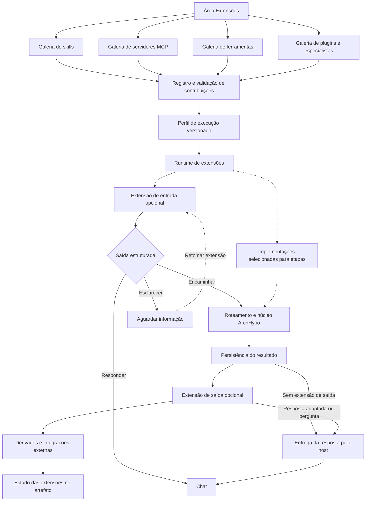
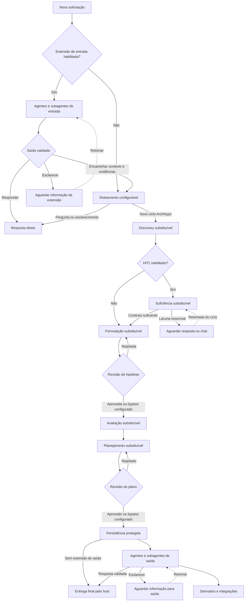
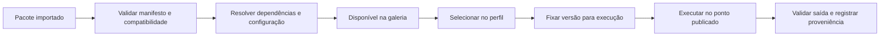
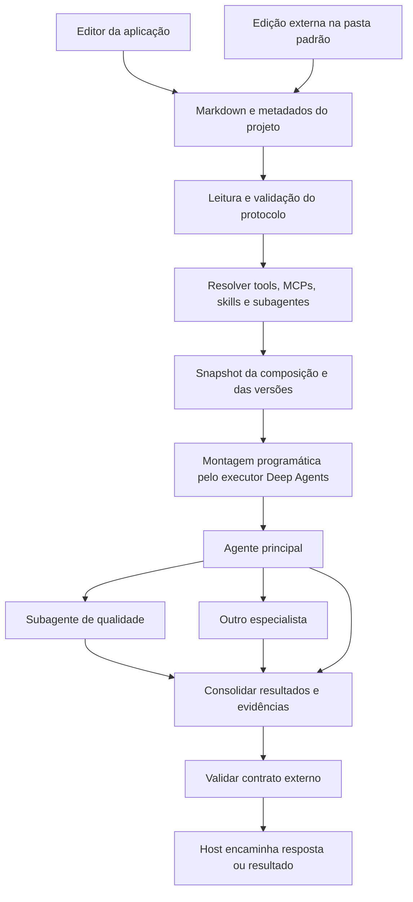
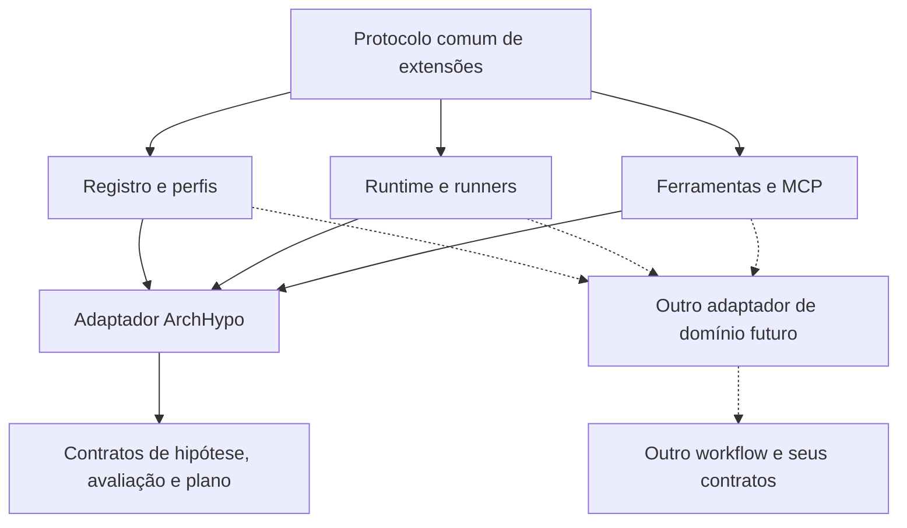

# ArchHypo Flow — especialistas, plugins e extensões

**Estado:** proposta de arquitetura; não representa funcionalidades já implementadas.

## Objetivo

Permitir que pesquisadores e usuários criem, importem e compartilhem especialistas, skills e integrações, preservando o fluxo ArchHypo como uma unidade utilizável sem conhecer sua implementação interna.

O produto terá uma área **Extensões**, com galerias de skills, servidores MCP, ferramentas e plugins. Usuários criarão agentes e subagentes por arquivos Markdown com metadados estruturados, editados na aplicação ou em uma pasta padrão. O runtime montará esses agentes programaticamente, sem exigir alterações no Python do núcleo.

Extensões poderão atuar na entrada, inclusive responder sem iniciar o ArchHypo, processar seus resultados na saída ou substituir implementações de etapas específicas. Os nomes “pré-hook”, “pós-hook”, “input agent” e “output agent” são provisórios; neste documento, usamos **extensão de entrada** e **extensão de saída** para descrever seus papéis.

Este documento segue as quatro etapas de resolução de problemas de Pólya: **compreender, planejar, executar o plano e revisar**. Apresenta responsabilidades, estruturas e contratos conceituais, sem código de implementação.

## 1. Compreender o problema

### 1.1. Qual problema estamos resolvendo?

Hoje, experimentar outro especialista exige alterar a aplicação. Queremos permitir, por exemplo:

- Importar uma skill sobre avaliação de incerteza.
- Substituir o especialista que classifica impacto e incerteza.
- Investigar contexto autorizado antes da formulação.
- Gerar um rascunho de ADR depois de um resultado concluído.
- Enviar um resultado para MongoDB por uma integração disponibilizada como ferramenta MCP.
- Comparar o fluxo padrão com configurações experimentais no benchmark.

O usuário configura capacidades e escolhe implementações para **pontos de extensão previamente definidos**. Cada extensão pode encapsular várias etapas, agentes coordenadores e subagentes. O núcleo conhece apenas seu contrato externo.

A proposta é um **runtime de agentes declarativos**, não a construção de um editor visual como Langflow ou n8n. Galerias, editor Markdown e validação de configurações oferecem o plug and play com escopo menor. Python continua responsável pelo runtime LangGraph/Deep Agents; TypeScript continua responsável pela interface. Não será gerado código Python a partir de cada arquivo.

### 1.2. O que existe hoje?

O agente está em `libs/archhypo-flow-agent`; a interface está em `apps/archhypo-flow-desktop`. O fluxo utiliza nós LangGraph e contratos estruturados. A referência mais direta das conexões atuais é o [grafo gerado](architecture/archhypo-flow-agent.mmd).

- Há roteamento, discovery conversacional, entrevista de suficiência, formulação, avaliação, planejamento, revisão humana, persistência e resposta.
- A análise documental usa Deep Agent sobre documentos extraídos e autorizados. Atualmente responde separadamente, sem encaminhamento estruturado à formulação.
- O planejador consulta referências de padrões em um catálogo.
- Há artefatos persistidos e alteração básica de status; ainda não há o ciclo completo de resultados, reavaliação e ADRs.
- Não existe ainda o protocolo de plugins nem as galerias propostas aqui.

### 1.3. O que significa manter o núcleo como caixa-preta?

Para quem usa o produto, o ArchHypo continua recebendo uma solicitação e produzindo resultados estruturados. Para quem cria uma extensão, o produto publica contratos limitados de entrada, saída e execução.

**A implementação de uma etapa pode mudar; suas obrigações perante o fluxo permanecem.** Uma substituição de avaliador não recebe poder para remover revisões, editar checkpoints ou alterar a topologia do grafo.

Uma mudança no significado dos níveis ou nas regras metodológicas deve ser identificada como uma variante experimental. Cumprir o formato de saída não demonstra equivalência metodológica.

### 1.4. Vocabulário da proposta

| Elemento | Responsabilidade |
|---|---|
| Skill | Instruções e referências reutilizáveis; não é, por si só, um agente em execução. |
| Ferramenta | Capacidade invocável, com entradas e saídas definidas. Pode ser local ou exposta por MCP. |
| Servidor MCP | Integração externa que pode disponibilizar ferramentas e outros recursos. Cadastrá-lo não habilita automaticamente tudo que oferece. |
| Especialista | Configuração executável de agente: instruções, modelo, skills, ferramentas e limites. |
| Ponto de extensão | Local publicado pelo fluxo onde uma implementação compatível pode atuar. |
| Extensão de entrada | Composição agêntica anterior ao roteamento normal, capaz de responder, pedir esclarecimento ou encaminhar contexto ao ArchHypo. |
| Extensão de saída | Composição agêntica que recebe um resultado persistido, pode adaptar a resposta, pedir esclarecimentos e produzir derivados ou integrações. |
| Subagente | Especialista referenciado por outro agente e disponibilizado para delegação pelo runtime. |
| Plugin | Pacote versionado que declara contribuições, dependências e compatibilidade. Pode fornecer skills, especialistas, ferramentas ou integrações. |
| Perfil de execução | Seleção versionada das extensões e configurações usadas em uma execução. |
| Artefato | Resultado persistido do processo, com referência ao perfil que o produziu. |

Uma skill pode ser importada isoladamente. Um plugin pode reunir várias contribuições, sem precisar conter todas as categorias.

## 2. Elaborar um plano

### 2.1. Arquitetura geral

Sem extensão de entrada habilitada, a solicitação segue diretamente ao roteamento atual. O resultado ArchHypo é persistido antes da extensão de saída. Uma falha ao exportar para MongoDB não desfaz a hipótese nem exige repetir o fluxo inteiro.

A extensão de saída pode apenas adaptar a resposta apresentada ao usuário, sem criar derivados nem executar integrações. Quando habilitada para essa finalidade, sua saída passa pela validação e entrega do host antes de aparecer no chat. O resultado estruturado persistido permanece preservado. Integrações externas independentes podem continuar em segundo plano; o card apresenta seu estado e resultado quando disponíveis.

### 2.2. Onde entram as extensões de entrada e saída?

Proposta inicial: **uma extensão de entrada e uma de saída selecionáveis por perfil**, ambas opcionais e desabilitadas por padrão. Cada uma pode conter um Deep Agent com ferramentas, skills e subagentes. Deep Agents será o primeiro executor declarativo suportado; o protocolo permitirá outros executores futuramente.

A extensão de entrada roda **antes do roteamento normal de uma nova solicitação**, quando habilitada no perfil. Sua saída tem três destinos publicados:

- **Responder diretamente:** entregar a resposta sem iniciar um ciclo ArchHypo.
- **Solicitar esclarecimento:** registrar uma pergunta e aguardar resposta para retomar a mesma execução da extensão.
- **Encaminhar:** entregar solicitação original, contexto, evidências e possíveis incertezas ao roteamento do ArchHypo. O núcleo verifica a aplicabilidade; o encaminhamento não obriga a formulação de uma hipótese.

O host identifica retomadas antes de despachar uma nova entrada. Respostas a uma entrevista ou revisão pendente do ArchHypo retornam ao núcleo; respostas a uma pergunta da extensão retomam essa extensão. Não se reinicia toda a investigação a cada mensagem. No modo não interativo, uma necessidade de esclarecimento retorna um estado estruturado de contexto insuficiente, sem espera por intervenção humana.

A extensão de saída inicia quando um novo resultado final ArchHypo é persistido. Pode pedir esclarecimento e retomar essa mesma execução quando o usuário responder. Não inicia uma nova execução apenas porque alguém abriu um card, fez uma pergunta ou mudou seu status. No MVP, respostas diretas da extensão de entrada não disparam essa extensão de saída nem criam um artefato ArchHypo fictício. Eventos futuros terão contratos próprios.

Seu protocolo distingue **entregar resposta**, **solicitar esclarecimento** e **concluir processamento sem substituir a resposta padrão**. Derivados e referências externas são campos opcionais. O host registra qual agente aguarda resposta — entrada, núcleo ou saída — e encaminha a retomada ao responsável, sem reiniciar o ciclo. No modo não interativo, esclarecimentos necessários ficam registrados como pendência, sem bloquear a execução esperando uma pessoa.

| Aspecto | Extensão de entrada | Extensão de saída |
|---|---|---|
| Entrada | Solicitação original, identidade da execução e contexto autorizado | Snapshot persistido do resultado, identificadores e referências autorizadas |
| Saída | Destino, resposta ou pergunta quando aplicável, contexto, evidências e lacunas | Disposição da resposta, texto ou pergunta quando aplicável, derivados opcionais, referências externas e estado de execução |
| Exemplo | Deep Agent analisa um repositório e responde ou encaminha uma possível incerteza | Deep Agent coordena especialistas para redigir ADR e exportar resultado |
| Limite | Não sobrescreve solicitação nem decide aprovação do núcleo | Não modifica o resultado original nem inventa decisão aceita |

**Exemplo de análise de código:** um agente configurado pelo usuário consulta um repositório autorizado e delega uma avaliação a um subagente de qualidade. Pode responder sobre a estrutura encontrada sem usar ArchHypo. Se identificar uma possível incerteza arquitetural, envia evidências e limitações para discovery. A investigação pode conter muitas etapas internas; o handoff continua estruturado.

Esse exemplo amplia as possibilidades das extensões propostas. Não altera o escopo do agente documental atual, que continua limitado aos anexos extraídos. O acesso a código dependerá das ferramentas configuradas especificamente para a extensão.

### 2.3. Grafo do núcleo e substituições

O grafo abaixo é uma **projeção proposta do caminho ArchHypo**, com revisões e pontos substituíveis. Não reproduz todas as saídas de esclarecimento do grafo atual.

As revisões continuam controladas pelo host. Desabilitar HITL mantém o comportamento automatizado previsto pelo produto, sem registrar aprovações humanas fictícias. Plugins não alteram essa política.

### 2.4. O que pode ser substituído no ArchHypo Flow?

As possibilidades abaixo são propostas, não pontos de extensão já disponíveis.

| Etapa atual | Personalização proposta | O que permanece sob controle do núcleo |
|---|---|---|
| `request_routing` | Modelo e instruções; substituição posterior de classificador | Rotas válidas, retomadas pendentes e preservação do ciclo |
| `documentary_research` | Especialista, skills e ferramentas sobre fontes autorizadas | Seleção e extração autorizadas; contrato de saída da rota; integração futura explícita |
| `architectural_uncertainty_discovery` | Especialista de identificação de incerteza | Saída estruturada e seleção de uma incerteza para o ciclo atual |
| `context_sufficiency_assessment` | Critérios complementares e especialista entrevistador | Estado de espera/retomada e bypass quando HITL está desativado |
| `hypothesis_formulation` | Instruções, modelo e especialista formulador | Contrato da hipótese, vínculo com a incerteza e validações existentes |
| `hypothesis_assessment` | Especialista e rubrica versionada de avaliação | Impacto e incerteza separados, campos e níveis válidos, justificativas |
| `technical_plan_generation` | Especialista planejador, skills e pesquisa técnica autorizada | Estrutura do plano, limites e padrões aceitos pelo contrato vigente |
| `hypothesis_review` e `technical_plan_review` | Apresentação e explicações auxiliares | Decisão humana, bypass configurado e registro da revisão |
| `artifact_persistence` | Integrações posteriores via extensão de saída | Persistência canônica, identidade e consistência do resultado |
| `direct_response_generation` e `response_generation` | Tom, idioma e instruções de apresentação | Envelope de resposta, fidelidade ao resultado e compatibilidade com o cliente |

Substituir instruções de uma etapa não significa substituir todos os prompts do sistema. O host combina regras do contrato, instruções do especialista e contexto autorizado. Validações de dados e controle do grafo são mecanismos de execução, não apenas recomendações no prompt.

### 2.5. Exemplo: outro especialista classifica como “high”

Um pesquisador publica um avaliador com uma rubrica diferente. O perfil seleciona esse especialista para `hypothesis_assessment`; discovery, formulação, planejamento e revisões continuam no fluxo existente.

O especialista recebe a hipótese e o contexto previsto no contrato. Devolve impacto, incerteza, classificação de qualidade e justificativas compatíveis com o esquema vigente. O artefato registra a identidade do especialista e a versão da rubrica.

Há duas situações distintas:

- **Outra implementação da mesma rubrica:** comparação de especialistas sob os mesmos critérios.
- **Outra definição de “high”:** variante metodológica declarada; resultados não são tratados automaticamente como equivalentes aos do perfil padrão.

Adicionar níveis ou remover campos exige uma nova versão de contrato e adaptação dos consumidores. Não é uma troca plug and play dentro do contrato atual.

### 2.6. O que é plug and play?

É instalar uma contribuição compatível, resolver sua configuração e selecioná-la no perfil **sem editar o grafo nem o código da aplicação**.

| Contribuição | Plug and play? | Condição |
|---|---|---|
| Skill documental | Sim | Formato compatível e seleção explícita pelo especialista |
| Avaliador alternativo | Sim | Mesmo contrato de entrada e saída do ponto de avaliação |
| Extensão de exportação | Sim, após configurar integração | Ferramenta disponível, conexão e credenciais resolvidas |
| Servidor MCP | Configurável | Servidor acessível e ferramentas selecionadas; instalar não garante conectividade |
| Novo campo obrigatório em toda hipótese | Não | Evolução de contrato, persistência e interface |
| Composição interna de agentes e subagentes | Sim | Referências resolvidas e recursos suportados pelo executor declarado |
| Nova topologia arbitrária do núcleo ArchHypo | Não no MVP | Seria outro perfil de workflow ou evolução do host |

Markdown descreve instruções, referências e composição. O runtime transforma essa configuração em um agente executável usando capacidades registradas. O usuário pode criar comportamentos novos combinando ferramentas existentes, sem editar o núcleo.

### 2.7. Protocolo declarativo de agentes em Markdown

Cada definição possui **metadados estruturados no início do arquivo (front matter YAML)** e um corpo Markdown com as instruções do agente. A sintaxe final será versionada pelo projeto; os campos abaixo descrevem o contrato proposto, não código de implementação.

| Campo conceitual | Finalidade |
|---|---|
| `id` e `name` | Identificador estável para referências e nome legível na interface |
| `protocol_version` e `version` | Versão do formato e da definição do agente |
| `type` | Executor solicitado; inicialmente `deepagent` |
| `model` | Referência à configuração de modelo, quando não herdada do perfil |
| `tools` | Identificadores de ferramentas disponíveis na galeria |
| `mcps` | Referências a conexões MCP configuradas; ferramentas expostas continuam selecionadas explicitamente |
| `skills` | Referências às skills disponibilizadas ao agente |
| `subagents` | Identificadores de especialistas que podem receber delegações |
| Contrato e capacidades | Pontos compatíveis, saída esperada, contexto acessível e limites de execução |
| Corpo Markdown | Papel, objetivos, critérios, orientações de delegação e instruções da tarefa |

**Exemplo descritivo:** `coder_analysis.md` define o agente “Code analysis”, executor Deep Agent, ferramentas de shell, pesquisa e Git disponíveis no catálogo, conexões `mcp_1` e `mcp_2` e referência ao subagente `qa_analysis`. O arquivo `qa_analysis.md` define seu próprio papel, instruções e ferramentas. O autor edita esses documentos; o runtime resolve as referências e monta os especialistas.

Declarar uma ferramenta chamada `bash`, `internet` ou `git` não cria sua implementação. A galeria mostra os identificadores realmente disponíveis e sua configuração. O agente recebe apenas as ferramentas resolvidas para sua definição; um subagente não herda indiscriminadamente todas as capacidades do pai.

#### Estrutura de arquivos proposta

| Caminho | Conteúdo |
|---|---|
| `.archhypoflow/agents/` | Definições Markdown dos agentes principais |
| `.archhypoflow/subagents/` | Definições Markdown dos especialistas delegáveis |
| `.archhypoflow/skills/` | Skills e suas referências locais |
| `.archhypoflow/profiles/` | Seleção dos agentes para entrada, saída e etapas substituíveis |
| `.archhypoflow/plugins/` | Manifestos de pacotes que agrupam e referenciam contribuições |

A pasta pertence ao projeto configurado. A localização de um arquivo não define seu ponto de execução: o perfil faz esse vínculo. Referências usam identificadores estáveis, e não nomes de exibição. Duplicidades e referências circulares entre subagentes são rejeitadas na primeira versão.

A interface e a pasta usam o **mesmo protocolo e as mesmas definições**. Para configurações locais, o editor da aplicação salva os arquivos correspondentes; o registro persistido funciona como índice e histórico de snapshots. Alterações externas são revalidadas antes de ativação, e edições concorrentes devem ser detectadas para evitar sobrescritas silenciosas. Importar um pacote materializa suas contribuições nesse modelo, com identificação de origem.

#### Montagem dinâmica pelo runtime

Esse protocolo será desenvolvido no ArchHypo Flow; não se presume que LangGraph carregue automaticamente essas pastas ou compreenda esse Markdown. LangGraph fornece a infraestrutura de execução, e o executor Deep Agents constrói os agentes a partir das definições resolvidas.

O autor pode descrever várias atividades e delegações. **Disponibilizar subagentes não impõe uma sequência fixa:** o agente decide como utilizá-los conforme as instruções e os recursos do executor. Dependências obrigatórias, paralelismo garantido e grafos arbitrários exigiriam construções adicionais no protocolo, fora da primeira versão. Delegações aninhadas só serão aceitas quando suportadas e validadas pelo executor; não se promete profundidade ilimitada.

### 2.8. Estrutura conceitual de um plugin

Cada pacote possui um manifesto e pode conter os seguintes elementos, sem precisar fornecer todos:

| Elemento do pacote | Conteúdo |
|---|---|
| Manifesto | Identificador, autor, versão, descrição, licença e versões compatíveis do protocolo |
| Contribuições | Pontos atendidos, especialistas, skills, ferramentas e integrações declaradas |
| Instruções Markdown | Papel do especialista, objetivos, limites e orientações de saída |
| Referências | Documentos auxiliares e critérios de avaliação |
| Dependências | Skills, conectores e ferramentas necessários, com versões ou restrições |
| Configuração | Campos exigidos, valores padrão e referências a credenciais externas ao pacote |
| Capacidades | Dados acessíveis e ferramentas utilizadas por cada contribuição |
| Exemplos de avaliação | Cenários e resultados esperados para avaliar compatibilidade e utilidade |

Importação e habilitação são operações distintas. Atualizar um plugin não muda silenciosamente ciclos em andamento. Cada ciclo fixa seu perfil; uma atualização se aplica a novas execuções.

### 2.9. Contratos de execução e tratamento de falhas

O protocolo comum deve carregar identidade da execução e da invocação, identidade do ciclo ArchHypo quando existir, versão do ponto de extensão, entrada autorizada, perfil fixado, limites e referências de contexto. A saída informa estado, dados estruturados, fontes utilizadas e diagnóstico público quando houver falha. Evidências encaminhadas devem preservar origem e limitações; um resumo textual isolado não substitui esse contrato.

- **Etapa substituta:** saída inválida não avança para a próxima etapa. Uma eventual política de fallback deve ser explícita e registrada; o benchmark precisa saber qual implementação realmente executou.
- **Extensão de entrada:** política configurada define se uma falha encerra a tentativa ou permite seguir ao roteamento padrão com a solicitação original. Falha não se confunde com resposta direta nem contexto insuficiente.
- **Extensão de saída:** falha fica associada à execução da extensão; o artefato principal permanece disponível.
- **Retomadas:** uma chamada já concluída não é repetida apenas porque o fluxo retomou de uma revisão.
- **Escritas externas:** usar identidade estável de operação e recursos de idempotência do destino. Após timeout com resultado desconhecido, reconciliar antes de repetir; o host não promete execução externa exatamente uma vez.
- **Limites:** duração, chamadas de ferramenta, orçamento e cancelamento são aplicados pelo runtime à composição inteira, incluindo delegações, e não apenas ao agente principal.

No MVP, ferramentas e runners são implementados pelo produto; pacotes declarativos os configuram. Plugins com código executável arbitrário exigem outro mecanismo de instalação e isolamento, fora do primeiro incremento.

## 3. Executar o plano: organização proposta

### 3.1. Pacotes e estruturas a criar

Começar como módulos do monorepositório, evitando criar serviços independentes antes de haver necessidade.

| Local proposto | Responsabilidade |
|---|---|
| `libs/archhypo-flow-agent/src/archhypo_flow_agent/extensions/contracts/` | Manifestos, descritores de pontos, entradas, saídas e compatibilidade |
| `libs/archhypo-flow-agent/src/archhypo_flow_agent/extensions/definitions/` | Leitura e escrita de Markdown com metadados, validação do protocolo e diagnósticos de edição |
| `libs/archhypo-flow-agent/src/archhypo_flow_agent/extensions/registry/` | Descoberta, importação, versões e resolução de dependências |
| `libs/archhypo-flow-agent/src/archhypo_flow_agent/extensions/runtime/` | Invocação, limites, estados, retomadas e seleção de implementação |
| `libs/archhypo-flow-agent/src/archhypo_flow_agent/extensions/runners/` | Montagem programática de Deep Agents e subagentes; adaptação aos contratos externos |
| `libs/archhypo-flow-agent/src/archhypo_flow_agent/extensions/integrations/` | Conexões MCP e catálogo unificado das ferramentas disponíveis |
| `libs/archhypo-flow-agent/src/archhypo_flow_agent/extensions/profiles/` | Composição e snapshot do perfil de execução |
| `libs/archhypo-flow-agent/src/archhypo_flow_agent/extensions/archhypo/` | Adaptadores entre pontos genéricos e contratos específicos do ArchHypo |
| `apps/archhypo-flow-desktop/src/features/extensions/` | Galerias, criação/importação, configuração e diagnóstico |
| `docs/extensions/` | Especificação pública e guia de autoria dos pacotes |

Estruturas existentes a ampliar:

- **Backend:** endpoints de catálogo, perfis, configuração e estado das extensões.
- **Persistência:** versões instaladas, perfis, snapshots e execuções de extensões, inclusive as que respondem sem criar ciclo ArchHypo.
- **Grafo:** chamadas aos adaptadores, mantendo transições e revisões no host.
- **Artefatos:** proveniência, derivados locais e referências externas.
- **CLI e benchmark:** seleção explícita de perfil e registro da configuração efetivamente usada.

Estruturas persistidas propostas: **contribuição instalada**, **conexão MCP**, **vínculo de ferramenta**, **perfil**, **snapshot do perfil**, **execução de extensão** e **derivado do artefato**. Credenciais ficam fora dos manifestos e dos snapshots exportáveis.

### 3.2. Experiência nas galerias

**Skills:** criar ou importar instruções e referências, consultar versões e visualizar quais especialistas as utilizam. Estar instalada não significa estar disponível a todos os agentes.

**MCPs:** cadastrar conexão com servidor existente, preencher configuração, testar conexão e selecionar ferramentas expostas. Criar um servidor MCP é desenvolvimento de uma integração, não uma capacidade automática do formulário.

**Ferramentas:** catálogo unificado de ferramentas nativas e MCP, com identificador utilizável no Markdown, origem, descrição, configuração necessária, disponibilidade e vínculos com especialistas. A galeria não duplica a implementação da ferramenta MCP. O editor sugere apenas referências conhecidas e informa dependências ainda não resolvidas.

**Plugins e especialistas:** criar ou editar Markdown, importar pacote, verificar dependências, configurar subagentes e escolher entrada, saída ou etapa compatível. O autor pode criar um pacote pela interface e exportá-lo no formato publicado. Erros indicam arquivo e campo afetados antes de permitir a ativação da configuração.

**Perfis:** inicialmente, um perfil padrão e perfis experimentais selecionáveis. Evitar heranças complexas entre usuário, projeto e conversa no MVP; cada execução resolve uma configuração inequívoca.

No card do artefato, apresentar o perfil utilizado, especialistas substitutos, estado da extensão de saída e derivados disponíveis. Um ADR gerado aparece como rascunho vinculado, não como uma decisão aceita automaticamente. Quando houver somente resposta direta da extensão de entrada, sua proveniência fica associada à execução e à conversa.

### 3.3. Como a arquitetura pode se tornar genérica?

Registro, manifesto, execução, ferramentas e proveniência não precisam conhecer hipóteses arquiteturais. O adaptador ArchHypo define seus pontos de extensão e valida os dados de domínio.

Isso permite reutilizar a infraestrutura em outro workflow, desde que ele publique seus próprios contratos. Não significa que um avaliador ArchHypo seja compatível com qualquer domínio.

A extração para bibliotecas independentes deve ocorrer quando um segundo consumidor demonstrar essa necessidade. O MVP mantém a implementação no pacote atual e testa a separação de responsabilidades.

**Escalabilidade da proposta:** novos agentes e combinações entram como dados versionados, sem mudanças no núcleo. O contrato externo permanece pequeno mesmo quando a extensão coordena muitos especialistas. Isso escala a autoria e a composição, mas não elimina custos de execução: concorrência, filas de tarefas longas e limites agregados precisarão acompanhar a demanda. O protocolo não depende de um editor visual nem da criação de um novo nó Python para cada agente do usuário.

### 3.4. Incrementos sugeridos

1. **Protocolo mínimo:** Markdown com metadados, diretório `.archhypoflow/`, identificadores, referências, perfis e contratos de entrada/saída.
2. **Montagem dinâmica:** carregar definições e montar um Deep Agent com um subagente e ferramentas do catálogo, sem editar Python para cada configuração.
3. **Execução nas bordas:** extensão de entrada com resposta direta, esclarecimento e encaminhamento; extensão de saída inicialmente com adaptação de resposta e retomada conversacional. Exportação pode ser acrescentada depois, com persistência das invocações.
4. **Galerias e editor:** skills, conexões MCP e ferramentas; criação/importação de especialistas e plugins usando o mesmo protocolo dos arquivos locais.
5. **Primeira substituição interna:** avaliador de impacto e incerteza, com rubrica versionada e comparação no benchmark.
6. **Ampliação seletiva:** formulação, planejamento e discovery, conforme validação dos contratos e necessidade de pesquisa.

Não é necessário implementar reavaliação de hipóteses ou todo o ciclo de ADRs para provar a arquitetura. Uma extensão de exportação já demonstra integração; um avaliador alternativo demonstra substituição interna. A qualidade de um ADR continuará dependendo das decisões e evidências disponíveis.

## 4. Revisar a solução

### 4.1. Critérios de aceitação

| Cenário | Resultado esperado |
|---|---|
| Nenhuma extensão habilitada | Fluxo padrão preservado, inclusive CLI e bypass HITL |
| Importar skill compatível | Disponível para seleção sem editar a aplicação |
| Criar agente e subagente por Markdown | Runtime monta a composição sem alteração no código do núcleo |
| Editar pela interface ou pela pasta | Mesma definição, validação e versionamento; conflitos de edição detectados |
| Referenciar ferramenta ausente ou subagentes circulares | Configuração não é ativada; diagnóstico identifica a referência inválida |
| Extensão de entrada conclui a tarefa | Resposta direta com proveniência, sem artefato ArchHypo fictício |
| Análise de código encontra possível incerteza | Contexto e evidências seguem para o núcleo avaliar a continuidade |
| Extensão pede esclarecimento | Resposta retoma a execução correta; modo não interativo retorna insuficiência |
| Selecionar avaliador alternativo | Só a implementação contratada muda; saída e proveniência são verificadas |
| Avaliador retorna campo inválido | Fluxo não persiste resultado como se fosse válido |
| Retomar revisão humana | Não repete extensão de entrada concluída nem perde o perfil fixado |
| Extensão de saída exporta para MongoDB | Referência externa e estado ficam vinculados ao artefato |
| Extensão de saída adapta a resposta | Chat recebe o texto validado; artefato estruturado original permanece preservado |
| Extensão de saída pede esclarecimento | Resposta retoma o agente de saída, sem reiniciar entrada ou núcleo |
| Exportação falha ou termina com estado desconhecido | Artefato preservado; reconciliação ou repetição controlada da integração |
| Atualizar plugin durante entrevista | Ciclo mantém versão original; novo ciclo pode usar atualização |
| Comparar rubricas diferentes | Relatório identifica a variante e não presume equivalência de níveis |

### 4.2. Avaliação para o mestrado

Separar duas perguntas de pesquisa:

1. **Extensibilidade:** é possível adicionar uma integração ou substituir um especialista sem alterar o núcleo? Medir mudanças exigidas, esforço de configuração e falhas de compatibilidade.
2. **Qualidade metodológica:** como cada especialista afeta qualidade da hipótese, coerência das justificativas e utilidade do plano? Comparar casos equivalentes, rubricas e revisão de especialistas.

Registrar versões, critérios, modelos, fontes e configuração ajuda a rastrear comparações; não garante respostas idênticas de modelos ou serviços externos. Os registros devem conter resultados e justificativas públicas, sem exigir cadeia de pensamento privada.

### 4.3. Decisões que precisam ser fechadas antes da implementação

- Quais campos de contexto cada ponto recebe na primeira versão do protocolo?
- Quais runners e ferramentas farão parte do catálogo inicial?
- Qual política de falha da extensão de entrada será o padrão de cada perfil?
- Qual rubrica representa o perfil ArchHypo padrão e como identificar variantes?
- Qual será a sintaxe final dos metadados e quais recursos de delegação o primeiro executor suportará?
- Onde serão armazenados credenciais, snapshots e derivados locais, além das definições na pasta do projeto?

**Recomendação final:** construir um runtime Python que monta Deep Agents a partir de Markdown, com agentes e subagentes criados na aplicação ou na pasta padrão. Galerias tornam as capacidades descobertas e configuráveis; contratos permitem responder diretamente, encaminhar ao ArchHypo ou processar seus resultados; versões e proveniência permitem avaliar as customizações. Essa composição declarativa é o mecanismo de plug and play proposto para o mestrado.
