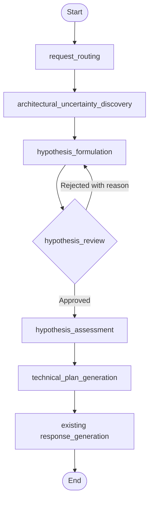
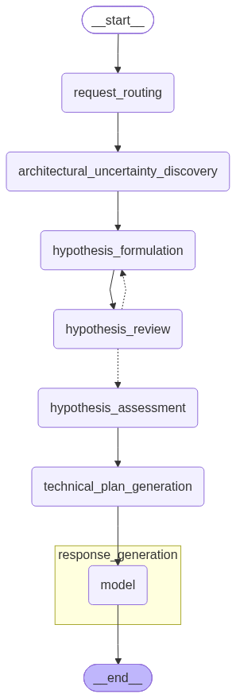

# ArchHypo Flow — current workflow

## Goal

This document describes the central ArchHypo path in the agent at
`libs/archhypo-flow-agent`. The user provides a natural-language input; the
agent tries to identify an architectural uncertainty, formulate and assess a
hypothesis, and propose a short technical plan. The user reviews the hypothesis
before the workflow continues.

The workflow is implemented as LangGraph nodes with Pydantic contracts for the
structured result of each stage.

## Implemented flow



1. **Routing:** deterministic; every input goes to
   `architectural_uncertainty_discovery`.
2. **Discovery:** identifies one central architectural uncertainty from the
   conversation and execution context. It does not read source code, folders,
   or documents.
3. **Formulation:** produces one declarative, testable hypothesis.
4. **Hypothesis review:** pauses the LangGraph run and shows the hypothesis in
   the app. Approval continues to assessment. Rejection requires a reason; that
   feedback is supplied to formulation and the revised hypothesis is presented
   for review again. The pause is checkpointed and can be resumed later.
5. **Assessment:** selects one NFR and assesses impact and uncertainty
   separately, with justifications.
6. **Technical plan:** proposes one to three actions tied to the hypothesis and
   its assessment. It screens the catalog index, considers up to five pattern
   candidates, reads at most three selected pattern references, and only allows
   patterns from those references in the generated plan.
7. **Response:** the existing conversational agent receives the structured
   result and replies using the current response behavior.

The graph-generated diagram is available at
[`docs/architecture/archhypo-flow-agent.mmd`](architecture/archhypo-flow-agent.mmd).
The rendered image is embedded below and saved at
[`docs/architecture/archhypo-flow-agent.png`](architecture/archhypo-flow-agent.png).



The yellow `response_generation` box groups the existing response agent. Its
inner `model` box is that agent's LLM call, not another ArchHypo stage.

## Minimum data produced

- One central uncertainty, or an indication that context is insufficient.
- A hypothesis with a title, testable statement, and justification.
- One non-functional requirement selected from Performance, Security,
  Reliability, Flexibility, Usability, and Productivity.
- Separate qualitative impact and uncertainty levels, each with a
  justification.
- One to three actions with an objective, description, trade-off, and
  ArchHypo pattern.

The plan contract allows these patterns: Architectural Spike, Architectural
Trigger, Bring the Specialist, Continuous Inspection, Learning from
Experiments, Plan for Preparation, Postpone Uncertain Decisions, Protective
Guideline, Quality Checkpoint, Software Analytics (What You Need to Know),
Technical Debt Management, and Tracer Bullets.

## Scope and limitations

- There is no direct-response route: even out-of-scope input enters the ArchHypo
  workflow, as required for this fixed-routing validation.
- Discovery uses conversation input only. It does not inspect repositories or
  documents.
- If context is missing, the flow continues with an exploratory formulation
  whose limitations should be explicit. There is not yet a context interview or
  clarification-question stage. Human review currently applies only to the
  hypothesis; there is no review gate after technical-plan generation.
- No Deep Agent, documentary research agent, multi-label quality tagging,
  semantic dossier, new database table, or artifact interface was added.
- Structured outputs are intermediate graph state/checkpoint data. There is no
  independently managed ArchHypo artifact or version history.
- Catalog references inform plan generation, but the chosen references are not
  yet exposed as citations or retained in an independently managed artifact.

## Coverage of the original ArchHypo technique

The foundational ArchHypo work describes four patterns: **Architectural
Hypotheses**, **Hypothesis Impact**, **Uncertainty Level**, and **Postpone
Uncertain Decisions**. The current graph covers them unevenly:

| Current stage | Relationship to the original technique | Current gap |
|---|---|---|
| `architectural_uncertainty_discovery` | Input-stage support; not one of the four patterns. | Extracts only from conversation/context; it does not gather documentary or implementation evidence. |
| `hypothesis_formulation` | Partial implementation of **Architectural Hypotheses**. A rejected hypothesis is reformulated from the user's required reason. | Creates one hypothesis for the current turn, without a lifecycle for resolving it beyond the review loop. |
| `hypothesis_review` | Human confirmation of the formulated hypothesis before impact and uncertainty are assessed. | Covers only the hypothesis stage; technical plans do not yet have an approval gate. |
| `hypothesis_assessment` | Partial implementation of **Hypothesis Impact** and **Uncertainty Level**. | Scores are based only on supplied text; the contract does not explicitly model the affected decision, alternatives, or evidence behind a rating. |
| `technical_plan_generation` | Initial implementation of **Postpone Uncertain Decisions**. It screens the catalog skill and grounds selected patterns in up to three Markdown references. | The plan has no structured outcome criteria, decision trigger, or reassessment cycle; consulted references are not yet preserved as plan provenance. |

The initial NFR selection is useful to this application, but it is not one of
those four foundational patterns. Multi-label quality tagging is also an
extension, not a prerequisite for implementing the original ArchHypo cycle.

## Suggested next increments

1. **Make actions verifiable.** Extend plan items with expected evidence and
   criteria that would confirm/refute the hypothesis or trigger a decision.
   Keep uncertainty reduction, impact mitigation, and decision timing
   distinguishable.
2. **Add a reassessment path.** When the user provides an action/experiment
   outcome, a future `hypothesis_reassessment` node can update impact and
   uncertainty separately, record whether the hypothesis is supported,
   refuted, or still open, and decide whether another plan is needed. This is
   the missing feedback loop; it should not execute the plan automatically.
3. **Add result lifecycle/persistence later.** Preserve prior assessments,
   plan outcomes, and decision timing as semantic result history rather than
   relying only on the latest chat checkpoint.

Context-sufficiency interviews and documentary discovery are useful extensions
described by the product proposal, but they are not additional core ArchHypo
patterns. They can be added separately once the basic plan-and-reassess cycle
is validated.

## Context

Global and project context already resolved by the application is composed
into each stage's system prompt. Context is passed through runtime and is not
appended to user messages. The final response continues to use the existing
conversational agent.

## Why `history.py` exists

`AgentService` uses `build_history_graph()` when no model is configured. This
no-op graph lets the application read persisted conversation/checkpoint
history while chat generation is unavailable (for example, when the API key
is missing). It is not an alternate chat workflow. With a model configured,
the service uses `build_graph()` and the ArchHypo stages shown above.

## Conceptual basis

ArchHypo applies hypothesis engineering to uncertainty in software
architecture decisions. A hypothesis represents an uncertainty that may
influence an architectural decision. Impact captures the architectural
consequences and effort required to switch to another alternative; uncertainty
captures how difficult it currently is to confirm or refute the hypothesis. A
technical plan can gather evidence, reduce impact or uncertainty, and identify
a responsible moment for making a decision.

Impact and uncertainty are distinct assessments and should not be combined
into a risk score. The goal is also not to eliminate every uncertainty before
development proceeds.

## References

- Silva, K.; Melegati, J.; Silveira, F.; Wang, X.; Ferreira, M.; Guerra, E.
  “ArchHypo: Managing Software Architecture Uncertainty Using Hypotheses
  Engineering.” *IEEE Transactions on Software Engineering*, 51(2), 430–448.
  [DOI: 10.1109/TSE.2024.3520477](https://doi.org/10.1109/TSE.2024.3520477).
- Silva, K.; Adolfo, L. B.; Coppe, A.; Silveira, F.; Ferreira, M.; Guerra, E.
  “Patterns for Using Hypothesis Engineering to Manage Architectural
  Uncertainties.” *EuroPLoP 2024*.
  [DOI: 10.1145/3698322.3698333](https://doi.org/10.1145/3698322.3698333).

Eduardo Guerra is a co-author of the cited work; ArchHypo is presented in
jointly authored publications.

## Local validation

```bash
cd libs/archhypo-flow-agent
uv run --group dev pytest
uv run --group dev ruff check .
```
