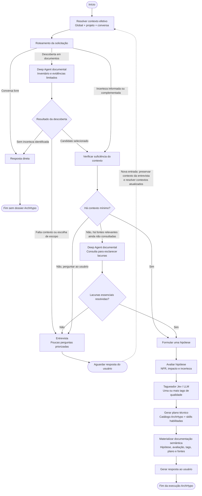

# ArchHypo Flow — proposta de evolução

> Documento sugestivo para orientar a evolução do ArchWise no contexto do mestrado. Não representa funcionalidades já implementadas nem uma decisão de migrar tecnologias. O objetivo é validar a aplicação da técnica ArchHypo com contexto adequado, investigação documental e planos fundamentados, mantendo a implementação simples.

## 1. Objetivo e limites

O ArchWise permite transformar uma incerteza arquitetural em uma hipótese, avaliar suas características e propor um plano técnico fundamentado na técnica ArchHypo.

A evolução proposta acrescenta:

- contexto global do usuário e contexto específico de projeto;
- projetos que agrupam conversas e documentos;
- entrevista para obter contexto mínimo antes da formulação;
- análise exploratória de documentos por um Deep Agent;
- skills documentais sistêmicas e personalizadas;
- um tagueador de requisitos de qualidade, usando Jev ou chamada de LLM equivalente;
- documentação semântica dos resultados e de suas fontes.

### Limites do MVP

- Manter a aplicação desktop com Tauri, React e backend atual.
- Não realizar migração para web neste escopo.
- Não introduzir autenticação, colaboração ou infraestrutura multiusuário.
- Contexto global e skills personalizadas pertencem ao perfil local do usuário.
- Não investigar código-fonte nem executar comandos na análise documental.
- Não executar scripts ou código contido em skills.
- Não introduzir banco vetorial, RAG complexo ou agentes adicionais sem necessidade demonstrada.
- Não implementar movimentação de conversas entre projetos.
- Preservar o núcleo da técnica ArchHypo.

## 2. Projetos e conversas

### Modelo proposto

```text
Projeto → zero ou muitas conversas
Conversa → zero ou um projeto
```

Uma conversa pode ser criada dentro de um projeto ou como conversa solta. A associação ao projeto não poderá ser alterada no MVP.

O projeto contém:

- identificação e nome;
- contexto específico, editável pelo usuário;
- documentos disponibilizados pelo usuário;
- suas conversas.

A conversa solta utiliza o contexto global, mas não herda contexto ou documentos de qualquer projeto.

### Exclusão

Excluir um projeto exclui suas conversas e os dados associados. A interface deve informar esse efeito e solicitar confirmação.

A exclusão precisa abranger metadados, anexos, checkpoints e documentação persistida, conforme a organização efetiva do armazenamento. Apagar apenas a linha do projeto não é suficiente.

## 3. Contexto global e contexto de projeto

### Contexto global

O usuário poderá preencher um contexto global nas configurações da aplicação. Uma futura entidade `global_preferences` pode armazenar esse conteúdo.

Exemplos de informações:

- setor de atuação;
- tipo de software desenvolvido;
- características do negócio;
- requisitos e restrições recorrentes;
- práticas corporativas relevantes.

Uma organização financeira, uma empresa de IoT e uma equipe que desenvolve sensores médicos possuem contextos diferentes. Essas diferenças devem orientar a análise sem serem inferidas pelo agente.

### Contexto de projeto

O projeto poderá ter instruções adicionais com suas características particulares. Embora possa ser apresentado como um “system prompt adicional”, o conceito de domínio é **contexto do projeto**: ele não substitui as instruções fixas do ArchWise.

### Composição sugerida

```text
Instruções fixas do ArchWise e da técnica ArchHypo
+ Contexto global do usuário
+ Contexto do projeto, quando houver
+ Solicitação e esclarecimentos da conversa
+ Evidências documentais consultadas sob demanda
```

Documentos e skills são fontes de conteúdo; não recebem autoridade para revogar regras de segurança ou o funcionamento da técnica.

### Atualização do contexto — recomendação

Uma alteração deve entrar em vigor na próxima execução, sem exigir recarregamento manual da interface.

Recomenda-se resolver o contexto efetivo no início de cada execução:

- execuções seguintes usam o contexto atualizado;
- uma execução em andamento mantém o contexto com que começou;
- resultados anteriores não são recalculados automaticamente;
- não é necessário reconstruir todo o grafo ao editar o contexto.

Essa recomendação evita alterações silenciosas e custos inesperados. O mecanismo exato de atualização ainda deve ser definido na implementação.

### Conflitos — recomendação

Exceções corporativas são legítimas. Em conflitos de requisitos de negócio, recomenda-se que o contexto do projeto prevaleça sobre o global, por ser mais específico.

Quando a exceção não estiver clara ou alterar significativamente a análise, o agente deve pedir esclarecimento. A precedência de contexto não permite desativar as regras fixas da técnica nem as proteções da aplicação.

## 4. Contexto insuficiente e entrevista

Antes de formular uma hipótese, o sistema deve verificar se compreende suficientemente o cenário. A instrução “não invente fatos” não substitui essa etapa de controle.

### Informação ausente versus incerteza arquitetural

- **Informação ausente:** o sistema não sabe qual restrição, cenário ou objetivo o usuário considera relevante.
- **Incerteza arquitetural:** o cenário é compreendido, mas existe uma dúvida sobre uma decisão, propriedade ou resultado arquitetural.

A entrevista busca suprir a primeira. A técnica ArchHypo trabalha sobre a segunda.

Não é necessário eliminar todas as dúvidas para avançar. Contexto suficiente não significa certeza sobre a solução.

### Contexto mínimo sugerido

A avaliação deve considerar, conforme a solicitação:

- finalidade e domínio do sistema;
- preocupação ou decisão arquitetural em discussão;
- cenário e partes afetadas;
- objetivo, restrição ou requisito de qualidade relevante;
- criticidade conhecida e consequências potenciais.

Esses itens são uma orientação, não um formulário rígido. Por exemplo, saber que um sensor é médico pode mudar substancialmente a análise.

### Comportamento da entrevista

- Fazer poucas perguntas por rodada, priorizadas por relevância.
- Aproveitar o contexto global, o projeto, as respostas anteriores e os documentos disponíveis.
- Não perguntar novamente o que já foi esclarecido.
- Aceitar “não sei” como resposta válida.
- Não preencher lacunas com fatos, métricas ou requisitos inventados.
- Explicitar ao usuário os limites e pressupostos relevantes.
- Permitir que o usuário complemente informações e informe possíveis resultados posteriormente.
- Se ainda não for possível formular uma hipótese útil, solicitar esclarecimento e aguardar nova entrada.

Uma hipótese pode ser exploratória ou menos concreta quando a própria incerteza justificar isso, desde que seus limites sejam explícitos e sua investigação seja possível.

### Human in the loop

Pode ser introduzido um mecanismo de confirmação humana para pressupostos relevantes ou para a hipótese formulada. O ponto exato e o mecanismo de pausa/retomada serão definidos posteriormente.

Para o MVP, a entrevista pode ser representada como um estado aguardando resposta, sem exigir desde o início uma infraestrutura sofisticada de aprovação.

## 5. Documentos e Deep Agent

### Escopo

O Deep Agent será um analisador exploratório de artefatos documentais de software, não um investigador de código-fonte.

Exemplos:

- documentação arquitetural;
- ADRs e RFCs;
- requisitos;
- descrições de integração;
- relatórios e notas operacionais;
- resultados de experimentos;
- documentos de negócio pertinentes à arquitetura.

Inicialmente, priorizar Markdown e texto. Outros formatos exigem decisão e tratamento de extração específicos.

### Disponibilidade

- Documentos adicionados ao projeto ficam disponíveis às suas conversas.
- Anexos adicionados a uma conversa ficam restritos àquela conversa.
- Conversas soltas também podem receber anexos.
- Anexar um documento a uma conversa não o promove automaticamente a documento do projeto.
- O usuário pode remover documentos e adicionar versões atualizadas.

A interface de projeto deve oferecer um seletor de arquivos. O agente recebe somente as fontes disponíveis no escopo daquela conversa.

### Responsabilidades do Deep Agent

- Realizar um inventário limitado dos documentos disponíveis.
- Consultar apenas os documentos relevantes, sob demanda.
- Descobrir possíveis incertezas arquiteturais quando solicitado.
- Buscar evidências que ajudem a responder lacunas identificadas na entrevista.
- Diferenciar observações documentais, interpretações e informação ausente.
- Citar documento e localização, como seção ou linhas.
- Identificar contradições ou sinais de desatualização sem decidir silenciosamente qual fonte é verdadeira.
- Retornar contexto insuficiente quando necessário.

Não deve produzir hipóteses, classificar risco ou gerar planos técnicos em substituição às etapas próprias do workflow.

### Limites e segurança

- Acesso somente leitura aos documentos disponibilizados.
- Sem execução de comandos, scripts ou código.
- Sem busca em diretórios externos ou no código-fonte do usuário.
- Limites de leitura, tamanho e número de fontes.
- Conteúdo documental não deve ser tratado como instrução de sistema.

Não se propõe um loop ilimitado de busca: após a consulta documental relevante, persistindo a lacuna, o sistema pergunta ao usuário.

## 6. Skills documentais

### Níveis e governança

Skills são globais para o perfil local; não haverá configuração por projeto no MVP.

| Categoria | Editar/excluir pelo usuário | Desabilitar |
|---|---|---|
| Núcleo ArchHypo | Não | Não no workflow ArchHypo |
| Sistêmica complementar | Não | Sim |
| Personalizada do usuário | Sim | Sim |

O usuário poderá criar e editar Markdown na interface da aplicação. As skills não executam scripts ou código.

### Anexo versus skill

- **Anexo:** fornece contexto ou evidência de uma conversa/projeto.
- **Skill:** fornece conhecimento e orientações reutilizáveis para executar uma tarefa.

Um padrão corporativo pode ser enviado como documento, mas sua representação como skill facilita o reuso em diferentes conversas e projetos.

### ArchHypo versus padrões técnicos

Os padrões da técnica ArchHypo e os padrões de solução arquitetural têm papéis distintos.

Exemplo:

```text
Padrão ArchHypo: Architectural Spike
Conhecimento técnico complementar: Outbox Pattern
Ação: experimentar entrega confiável de eventos no cenário informado
```

Outbox, Kafka e padrões internos não devem substituir indiscriminadamente os padrões oficiais no campo que representa a técnica ArchHypo.

### Planejamento

O planejador deve consultar o catálogo ArchHypo e, quando relevantes, skills complementares habilitadas. O resultado deve indicar quais referências fundamentaram as ações.

Um agente adicional especializado em planejamento corporativo pode ser considerado posteriormente. Para o MVP, ampliar o planejador existente é a opção mais simples; a divisão não é obrigatória.

## 7. Tagueador de requisitos de qualidade

### Papel proposto

Adicionar um agente/subagente lógico de classificação, implementado por uma chamada a Jev ou a um LLM equivalente, que atribui **uma ou mais tags de requisitos de qualidade** ao material arquitetural analisado.

A referência proposta é a abordagem/taxonomia de qualidade associada a Kazman. A lista exata de categorias, sua fonte bibliográfica e as regras de classificação serão definidas em uma etapa posterior. Segurança é um exemplo; não se fixa neste documento uma taxonomia definitiva.

O tagueador não é um executor de ferramentas ou um agente exploratório. Pode ser uma chamada estruturada e delimitada dentro de um nó do grafo.

### Entrada sugerida

- incerteza normalizada;
- hipótese;
- contexto relevante;
- evidências documentais disponíveis;
- avaliação arquitetural já produzida.

### Saída sugerida

- uma ou mais tags de qualidade, quando houver fundamento;
- justificativa curta para cada tag;
- indicação de insuficiência quando não houver base para classificar;
- identificação da versão da taxonomia e do classificador utilizado.

As tags devem ser validadas contra a taxonomia adotada. Não devem conter categorias inventadas nem afirmações de conformidade não demonstradas.

### Relação com a avaliação atual

A avaliação existente e o tagueamento têm responsabilidades distintas:

- a avaliação mantém os níveis e justificativas definidos pela técnica;
- o tagueador acrescenta uma classificação multilabel de requisitos de qualidade;
- tags não substituem os níveis de impacto/incerteza nem equivalem a um escore de risco;
- a eventual revisão da avaliação de risco será especificada separadamente.

Atualmente, o contrato contém um NFR por classificação. A proposta de múltiplas tags deve ser modelada explicitamente, sem alterar esse significado silenciosamente.

### Documentação enriquecida

O tagueador anexa semanticamente suas tags à documentação do resultado em elaboração. A materialização final pode apresentar uma seção como:

```text
Requisitos de qualidade associados
- Segurança: justificativa fundamentada no cenário informado.
- Outra categoria válida: justificativa correspondente.
```

“Anexar” significa acrescentar campos/seções estruturados ao resultado atual, não editar os documentos originais enviados pelo usuário nem persistir raciocínio privado.

Na evolução sugerida, o tagueamento acontece após a avaliação e antes do plano. Assim, as tags também podem orientar a seleção de ações. A posição definitiva ainda pode ser ajustada quando forem definidos taxonomia e contrato.

## 8. Possível evolução do grafo

O diagrama representa responsabilidades propostas, não nomes definitivos de nós ou funcionalidades já disponíveis. A composição do contexto é uma etapa lógica e pode ser implementada no serviço de execução, sem precisar ser um agente.



### Observações sobre o fluxo

- As etapas de suficiência devem reconhecer quando uma resposta continua uma entrevista, em vez de tratar toda mensagem como uma nova incerteza.
- A seleção de candidato ou confirmação de escopo não autoriza combinar incertezas independentes em uma única hipótese.
- Consultas documentais devem ser limitadas; não se propõe repetir buscas indefinidamente.
- Respostas diretas não produzem dossier ArchHypo.
- Perguntas e respostas de entrevista são interação de contexto; não constituem um resultado ArchHypo concluído.
- Um ponto de confirmação humana de pressupostos ou da hipótese poderá ser inserido posteriormente. Ele não é obrigatório neste diagrama.
- O tagueador é uma classificação estruturada, não uma substituição das demais etapas.

## 9. Documentação e proveniência

A documentação deve registrar resultados semânticos e suas bases, não um despejo de checkpoints ou traces.

Conteúdo sugerido para cada execução concluída:

- identificação da conversa/projeto e execução;
- incerteza e hipótese;
- avaliação e justificativas;
- tags de qualidade e justificativas;
- plano técnico;
- documentos e skills consultados;
- lacunas e pressupostos explicitados;
- resposta final e status.

Recomenda-se identificar a versão dos contextos, documentos e skills utilizada na execução, sem exigir um sistema completo de versionamento no MVP. Pode-se começar por identificadores e datas ou hashes quando necessário.

Não persistir prompts completos, traces brutos de ferramentas, cadeia de pensamento ou raciocínio privado na documentação semântica.

Remover ou atualizar uma fonte não deve recalcular ou reescrever automaticamente resultados antigos. Ao excluir o projeto, porém, seus resultados associados também são removidos, conforme a regra de exclusão definida.

O modelo final de dossier e snapshots de execução será especificado separadamente. Este documento não aprova o modelo de armazenamento atual como contrato definitivo.

## 10. Relação com a implementação atual

Pontos de apoio existentes:

- Persistência SQLite de conversas e infraestrutura de migrações.
- `project_id` previsto no contexto de execução, ainda sem entidade de projeto na migração atual.
- Grafo com separação entre roteamento, descoberta, hipótese, avaliação e plano.
- Discovery com evidências e status de contexto insuficiente.
- Planejador com `SkillsMiddleware` e catálogo ArchHypo governado.
- Contratos Pydantic para resultados estruturados.

Mudanças necessárias:

- entidade de projeto e vínculo opcional da conversa;
- persistência do contexto global e de projeto;
- composição dinâmica e consistente do contexto;
- documentos em escopo de projeto e de conversa;
- protocolo de discovery exclusivamente documental;
- estado e contratos da entrevista e suficiência;
- registro e habilitação de skills do usuário;
- ampliação do plano para referências técnicas complementares;
- contrato e nó de tagueamento;
- apresentação de tags e proveniência na documentação.

## 11. Complexidade e maturidade estimadas

Maturidade indica clareza da proposta para iniciar o desenho, não percentual implementado. Os valores são estimativas qualitativas após a discussão.

| Item | Complexidade relativa | Maturidade da proposta |
|---|---|---|
| Projetos e vínculo das conversas | Baixa–média | 9/10 |
| Contexto global e de projeto | Baixa–média | 8/10 |
| Documentos Markdown/texto por escopo | Média | 8/10 |
| Discovery exclusivamente documental | Baixa–média | 8/10 |
| Entrevista e suficiência de contexto | Média–alta | 7/10 |
| Skills sistêmicas e do usuário | Média | 8/10 |
| Planejamento com skills complementares | Média | 7/10 |
| Tagueador Jev/LLM de qualidade | Média | 5/10 |

A principal dificuldade não é adicionar tabelas ou nós: é preservar a semântica da técnica, evitar inferências indevidas e definir critérios verificáveis para avançar após a entrevista.

## 12. Sequência sugerida

1. Definir os contratos de projeto, contexto, documentos e execução.
2. Implementar projetos e composição de contexto.
3. Introduzir avaliação de suficiência e entrevista.
4. Adaptar o Deep Agent e disponibilizar documentos por escopo.
5. Introduzir skills personalizadas globais e sua governança.
6. Ampliar o planejador preservando os padrões ArchHypo.
7. Definir a referência de qualidade, a taxonomia e o contrato do tagueador.
8. Integrar tags, fontes e pressupostos à documentação.
9. Validar o fluxo com cenários de pesquisa e avaliação especializada.

### Decisões ainda abertas, sem bloquear o desenho geral

- Critério operacional de suficiência para diferentes cenários.
- Momento e mecanismo de confirmação humana de pressupostos/hipótese.
- Taxonomia exata e referência bibliográfica de Kazman.
- Papel específico de Jev, modelo utilizado e comportamento em falhas de classificação.
- Contrato definitivo do dossier e das snapshots de execução.
- Política detalhada de limites de documentos e skills.

Não se propõe implementar toda a evolução de uma vez. Cada incremento deve manter o workflow executável e ser validado por casos como contexto insuficiente, resposta “não sei”, exceção de projeto, fontes contraditórias, skill desabilitada e classificação com múltiplas tags.
